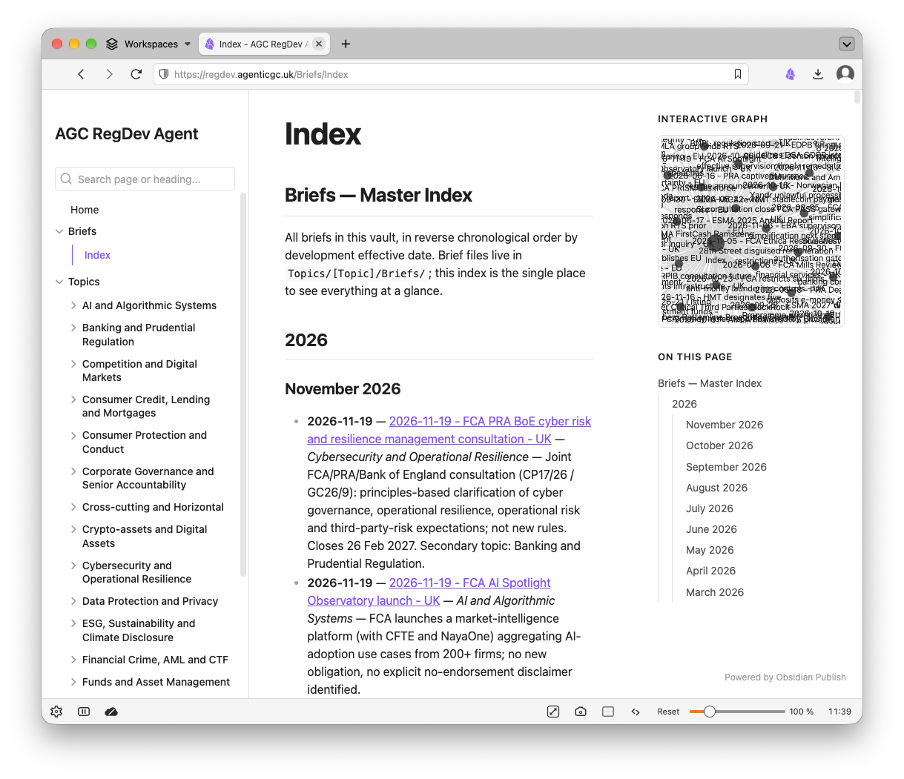
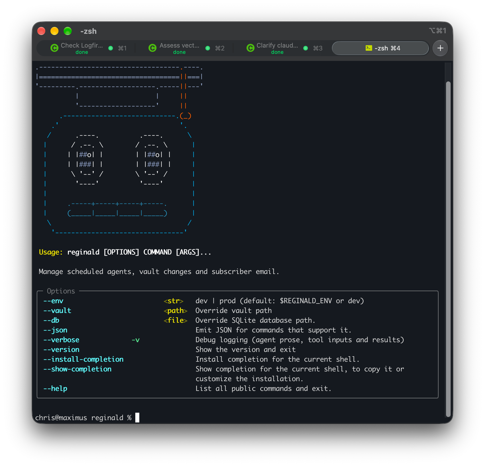
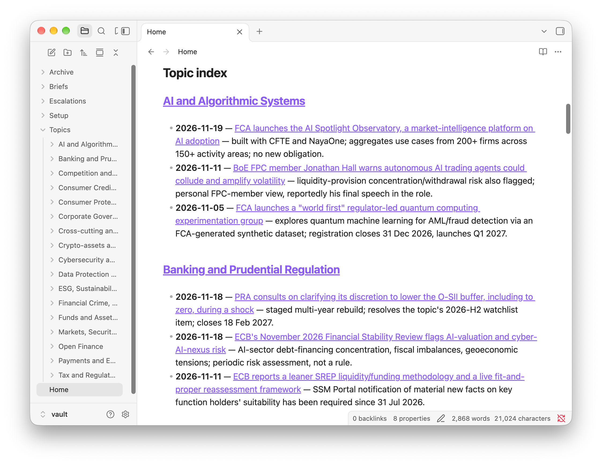
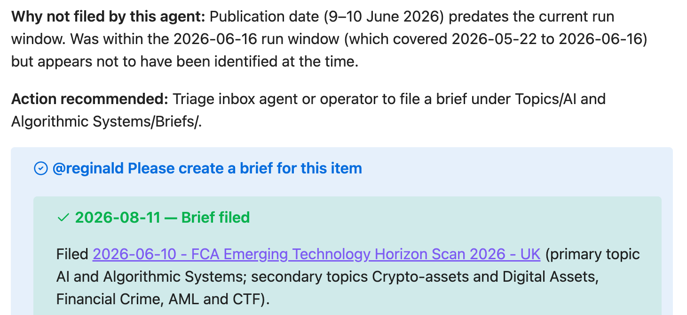
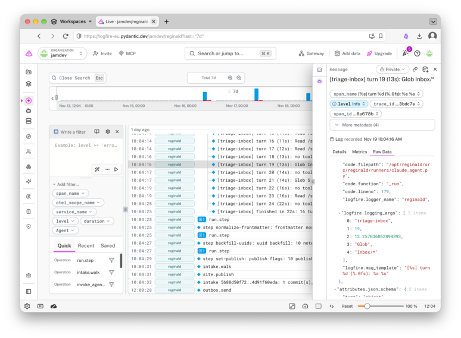

> [!CAUTION]
>
> **Reginald** is a research project and not production-quality code.  Bug reports welcome via GitHub Issues. 

----


# Reginald

Reginald (he/him) is an AI agent to help a legal or compliance team keep up with regulatory change.  He runs within a self-built agent orchestrator, programmed in Python.

He researches new developments, keeps track of key dates and emails each team member about the topics they follow. 

The work lives in a shared collection of Obsidian (https://obsidian.md) notes that the team can read, question and edit at any time.  These notes can be published to the web as a knowledge-base.



## Quickstart

Review [Server installation](docs/INSTALL.md#one-time-install) 


## How he works

Reginald is a command-line program written in Python:



He uses LLMs to research and draft briefs of legal and regulatory developments.  He combines programmatic Python with LLM and tool usage in a loop (the ReAct pattern), into several 'tasks', run on a schedule, so that Reginald can pick up new developments every working day.  [Tasks documentation](docs/TASKS.md) 

### Models

Reginald prefers Claude.  This is because, for personal research and development, Reginald has been built to use a Claude Pro subscription.  For deployment, especially into a multi-user environment, Reginald can use the Claude API directly. Reginald includes cost monitoring and control, to keep bills in check. 

Although Reginald prefers Claude, he is able to use other models.  Through a model-agnostic abstraction - TaskRunner - tasks can also use Codex or any provider supported by Pydantic AI.  I haven't fully tested this yet.  [Runner configuration](docs/RUNNERS.md)

### Schedule

Reginald runs his tasks to a schedule:

| Task or service             | Default schedule                 | What it does                                                 |
| --------------------------- | -------------------------------- | ------------------------------------------------------------ |
| `action-edits`              | Daily, 01:00                     | Works through questions and to-dos left in notes. Skips the agent when the queue is empty. |
| `research-new-developments` | Weekdays, 09:00                  | Researches regulatory developments and drafts briefs.        |
| `triage-inbox`              | Weekdays, 10:00                  | Classifies incoming material against the team’s topic list.  |
| `update-trackers`           | Mondays, 08:30                   | Reviews and updates the regulatory trackers.                 |
| `key-dates-digest`          | Mondays, 09:30                   | Collects upcoming deadlines and other key dates into a digest. |
| `archive-sweep`             | First Monday of the month, 10:00 | Archives superseded notes and tidies their metadata.         |
| `source-verification`       | Third Monday of the month, 10:00 | Checks cited sources and flags changed or unavailable material for review. |
| `vault identify-changes`    | Daily, 11:30                     | Records changes from new vault commits and queues callouts for `action-edits`. |
| `outbox drain`              | Weekdays, 12:00                  | Sends subscriber digests and retries failed deliveries when due. |

### Tool use

Reginald includes tool support using MCP servers.

For example, Reginald can use Brave Search alongside Claude’s built-in web search. Each task lists the tools it may use unattended. 

### Hosting

Reginald is designed to be always on, in a largely 'set-and-forget' pattern.

Reginald runs on a lightweight server, such as a Raspberry Pi or a VPS. This idea came out of an earlier experiment running his persona as an agent in the Claude Desktop app. That relied on my laptop being switched on and regularly failed.  The current iteration of Reginald is what it looks like to go down the rabbit hole of building my own AI orchestrator. 

I've been running him for several months on a cheap VPS with very little systems administration overhead. I started my working life managing Linux servers for ISPs, before becoming a lawyer. Managing a VPS was a fun nostalgia trip for me.  I expect it might not be so much fun for others; this is a real limitation of this project.  I wrote about what this means for lawyers in [Don't do DevOps](https://the.agenticgc.uk/posts/computing-really-is-changing/#dont-do-devops).  

If you really want to have a go: [Installation instructions](docs/INSTALL.md)

### Email 

Reginald sends a daily email with updates.  

These are simple emails that link through to the content via URL, currently to a vault published by Obsidian Publish (see below). 

Reginald currently uses [Postmark](https://www.postmarkapp.com/) for outbound email - mostly because I have a stash of credits left over from [before they went pay-monthly](https://postmarkapp.com/support/article/1287-postmark-is-retiring-credits).  

Email is abstracted via an EmailProvider protocol, so you are welcome to roll your own.  I should probably add SMTP at some point.  You can use Reginald without email by setting emails to output to the console.

### Vault

Reginald maintains his know-how database in the format of an [Obsidian](https://obsidian.md/) vault.  

Obsidian is a fantastic tool for creating knowledge-bases using the [Markdown](https://markdown.org) format.  Markdown has become something of a native format for AI, and so there are clear benefits to adopting it here.   Whereas PDFs and Word documents can be brittle and prone to burning tokens (e.g. on unnecessary formatting and document glitches), Markdown is lightweight and efficient for computers to read and edit.

Obsidian brings a UI that can sit atop the vault and make it easy for humans to read and edit.  No Microsoft Word or Adobe Acrobat here. Obsidian is a commercial program but is very accessible, being [free of charge](https://obsidian.md/pricing) for both personal and commercial use.  Reginald does not rely on Obsidian's native sync function because it uses Git for collaboration instead, as above.



### Publish

Reginald publishes his know-how vault to the web.

Obsidian includes a [publishing facility](https://obsidian.md/publish) as a paid-for add-on.  It is cheap, reliable and can be [put behind a password](https://obsidian.md/help/publish/security), to avoid the content being open to all.   This is probably sensible; having the vault open-access is a convenience rather than an intention.

Publishing is not yet abstracted into a pluggable architecture to allow the vault to be exported to other formats, e.g. PDFs in a hierarchical filesystem / Word documents / Dropbox / Google Docs.  You are welcome to pick this up. 


### Collaboration

Reginald supports multi-user collaboration by default.  

Vault collaboration uses Linus Torvalds’s [Git](https://git-scm.com).  Reginald acts as a contributor, with its own Git identity. [About Git](https://git-scm.com) · [How a run works](docs/USAGE.md#the-run-pipeline) Like the hosting model, this is a limitation of this project for real-world use.  

I've said many times that programming and lawyering rely on many common transferable skills, but even I can't imagine that all (many? most?) sensible lawyers would have the patience to administer their know-how vault using developer command-line tools. Therefore, in Reginald, an administrator can add non-technical team members as *subscribers*.  Subscribers receive email alerts with links to new content in topics of interest to them.  This replicates the experience of many a current legal team, where one person - often junior - might be responsible for collating and circulating know-how materials.  This is a necessary but time-consuming job. Reginald could free up their time to work on those legal matters with a more immediate value to their business.

Building out a more intuitive collaboration layer could be an interesting future direction for this project.  My experience of teaching lawyers to use new technology is that adoption curves can vary significantly:  some will enjoy using a new UI immediately, while others will take longer to adapt. If a new tool relies on a new interface, its success or failure can be influenced by the slowest adopters in the team.  This is why I preferred email for Reginald, and why a UI would be a very carefully planned addition. 


### Human-in-the-loop

Reginald reads other contributors' edits from the vault and works out whether he needs to reply to them.   This leverages the [Callouts](https://obsidian.md/help/callouts) feature of Obsidian.

This can be used anywhere in the vault, for example to request corrections or clarifications, but is particularly useful for escalations.  Escalations happen when Reginald is not sure how to proceed.  He raises an escalation and asks for instructions.  For example, here he comes across a regulatory update which was not found by earlier scans.  Because some time has now passed, he asks whether it should be included.  I have responded in blue, and Reginald has responded in green:



Reginald also reads files in the Inbox/ folder in the vault. For example, create `Inbox/Review FCA consultations.md` with just this content, then commit and push it to the vault’s `main` branch:

```
> [!todo] @reginald Review the FCA consultations page
> Check https://www.fca.org.uk/publications/consultation-papers for open
> consultations relevant to our topics. Reply here with links and deadlines.
```

In the future, an email inbox or web interface could offer another way to ask Reginald a question. Email (or, for that matter, Slack or Teams) would be simple enough to implement, either with MCP calls or a dedicated API integration into a relevant provider.  

A web interface might be trickier as to be intuitive it would likely need content viewing and editing - functionality that is currently provided by Obsidian.  An Obsidian plugin is feasible, perhaps.  

Feasibly, other agents could be allowed to edit the vault and Reginald would treat them like human contributors.  It would be fun to give a couple of agents access to a shared vault alongside Reginald to observe how effectively they could check and challenge each other's work.

## Behind the scenes

### Database

Reginald maintains an SQLite database to track and log progress, maintain task queues and to store user data such as subscribers' email addresses and topic subscriptions.

This is helpful to maintain state, for example:

- Change detection: It records the last Git commit scanned, which notes changed and who changed them. The next scan can pick up from that commit.

- Email: It stores subscribers, their topic preferences and delivery history. If a teammate corrects a brief, Reginald can work out who should hear about it, queue the update once per subscriber and track failed sends for retry.

- Tasks and follow-up: It stores queued tasks, run outcomes, costs and errors, along with outstanding questions and to-dos found in notes.

- Vault indexes: It keeps topic IDs and escalation numbers, paths and statuses so the CLI can look them up. Those indexes can be rebuilt from the vault.

  [Database schema](src/reginald/db/schema.py)

So, it is convenient as-is.  Plus, over time, having a cross-reference of metadata such as topic IDs and escalations - as between the frontmatter of the vault and the database - should help protect against model drift and vault corruption, but I haven't tested this yet.  

### Observability

Logfire records agent runs, tool calls and configurable excerpts of the conversation. [Read an agent conversation](docs/LOGGING.md#read-the-agent-conversation)

You'll need an account and a write token.  It's documented in [INSTALL.md](docs/INSTALL.md).




## Security and risk

Reginald really is provided "as-is" - see below - and your use is entirely at your own risk.  The risks (including legal and security risks) of scraping third-party websites for regulatory developments are for you to assess.  

Reginald is a personal research project into the use of agents - both to write code and to conduct legal work. I don't offer Reginald as a service and have no commercial interest in him - hence the MIT licence below.  

Reginald was developed by me, Claude Code and OpenAI's Codex.  Inevitably, the LLMs wrote almost all the actual Python code, with me directing and testing.  This was still a significant time commitment.  My knowledge of Python was helpful but I have not reviewed every line of code - far from it.  The purpose of sharing Reginald is to allow others to inspect how he was built and conduct their own research.  I do not recommend using Reginald in production.

Some notes on information security:

- **Server** — Reginald runs on a server that needs outbound network access on web ports only.  Reginald runs as his own user without wheel membership or sudo permissions. Further, the host server can be entirely firewalled to prevent public inbound access in the usual way (e.g. Cloudflare tunnels or Tailscale; outside the scope of this note).  Nevertheless, server hardening is recommended. As is running Reginald on a single-purpose container, VPS or bare-metal server, rather than a shared system.
- **Website** — Reginald trusts contributors to a shared Git vault. Git records edits, and successful runs can publish without human review.  Any content can be placed in the vault, including maliciously.  Reginald is only as secure as your least security-conscious contributor.  
- **Tool usage** — Each task has an explicit list of permitted tools. Instructions in a note cannot grant additional permissions.  None of the tasks grant Bash shell usage.  Nevertheless, tool use has not been hardened.  A malicious prompt could well persuade an agent to read outside the vault, potentially including sensitive material like password hashes or API keys.  I have been researching [agent security perimeter](https://code.claude.com/docs/en/agent-sdk/secure-deployment) approaches but these are as yet unimplemented. 

- **User content** — Callouts, documents and web results can contain prompt injections. These can still steer the agent into making a misleading edit with an authorised tool.  A defence-in-depth approach would be beneficial, as recommended by [OWASP](https://cheatsheetseries.owasp.org/cheatsheets/LLM_Prompt_Injection_Prevention_Cheat_Sheet.html).
- **Drift** — Each run starts with a named model and fresh task instructions. Reginald does not automatically detect changes in judgement or factual accuracy over time. As above, some care has been taken to ensure metadata is tracked to reduce vault corruption, but I haven't yet got my head around how you'd calibrate a baseline against which to measure Reginald's accuracy or smarts, especially programmatically. Drop me a line if you have expertise to share.
- **Not tested** — I have not tested Reginald against adversarial attacks.  If you are crazy enough to want to put Reginald into production, I would recommend an infosec review.  If you are doing this then please let me know. I'd love to get the learnings.

## Documentation

- [Install and deploy](docs/INSTALL.md)

- [Operate Reginald and contribute to the vault](docs/USAGE.md)

- [Define a task and choose its runner and steps](docs/TASKS.md)

- [Understand and configure task steps](docs/STEPS.md)

- [Configure Claude, Pydantic AI and Codex task runners](docs/RUNNERS.md)

- [Add MCP servers and grant tools to tasks](docs/MCPSERVERS.md)

- [Inspect a run in the journal or Logfire](docs/LOGGING.md)

- [Work on the codebase](AGENTS.md)

  

## Licence 

Reginald’s contributors license their contributions under the **MIT Licence** to the extent they have the right to do so. Third-party material remains subject to its applicable licence terms and copyright notices. 

### MIT Licence

Copyright (c) 2026 Chris James

Permission is hereby granted, free of charge, to any person obtaining a copy of this software and associated documentation files (the "Software"), to deal in the Software without restriction, including without limitation the rights to use, copy, modify, merge, publish, distribute, sublicense, and/or sell copies of the Software, and to permit persons to whom the Software is furnished to do so, subject to the following conditions:

The above copyright notice and this permission notice shall be included in all copies or substantial portions of the Software.

THE SOFTWARE IS PROVIDED "AS IS", WITHOUT WARRANTY OF ANY KIND, EXPRESS OR IMPLIED, INCLUDING BUT NOT LIMITED TO THE WARRANTIES OF MERCHANTABILITY, FITNESS FOR A PARTICULAR PURPOSE AND NONINFRINGEMENT. IN NO EVENT SHALL THE AUTHORS OR COPYRIGHT HOLDERS BE LIABLE FOR ANY CLAIM, DAMAGES OR OTHER LIABILITY, WHETHER IN AN ACTION OF CONTRACT, TORT OR OTHERWISE, ARISING FROM, OUT OF OR IN CONNECTION WITH THE SOFTWARE OR THE USE OR OTHER DEALINGS IN THE SOFTWARE.


## Third-party code

Reginald includes material adapted from [Alembic](https://github.com/sqlalchemy/alembic) in two files.

- [Migration script template](migrations/script.py.mako) — the template for generating database migrations. [Alembic source](https://github.com/sqlalchemy/alembic/blob/main/alembic/templates/generic/script.py.mako)
- [Migration configuration](alembic.ini) — the logging configuration comes from Alembic’s default settings. [Alembic source](https://github.com/sqlalchemy/alembic/blob/main/alembic/templates/generic/alembic.ini.mako)

Copyright 2009-2026 Michael Bayer. The [MIT Licence](#mit-licence) above applies to this material under that copyright notice. [Alembic licence](https://github.com/sqlalchemy/alembic/blob/main/LICENSE)

Reginald's installer downloads and installs a number of open-source Python modules.


